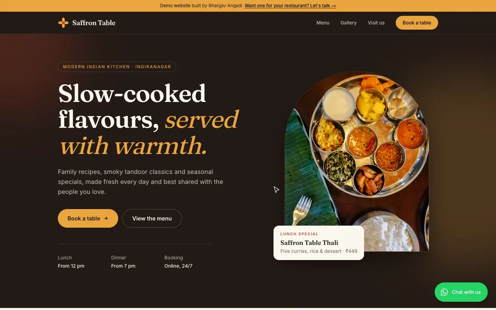
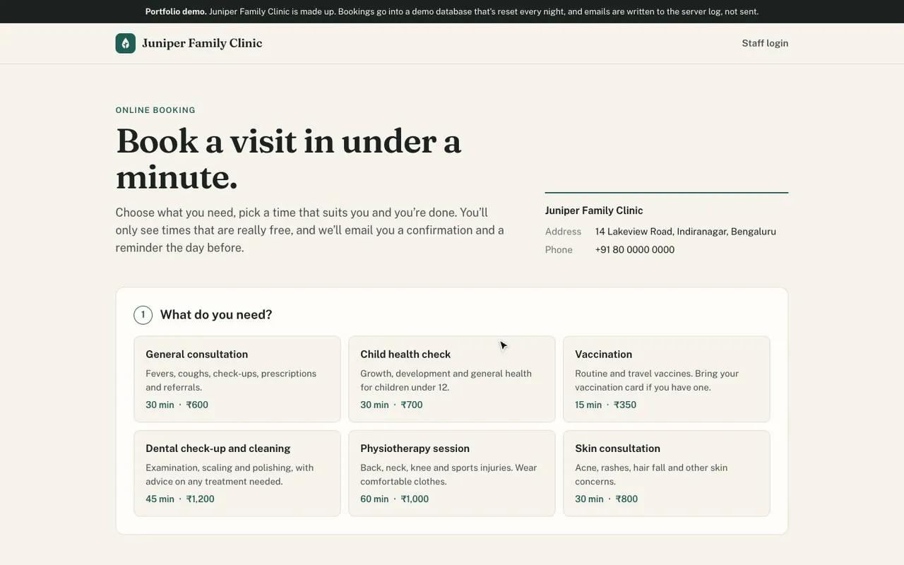
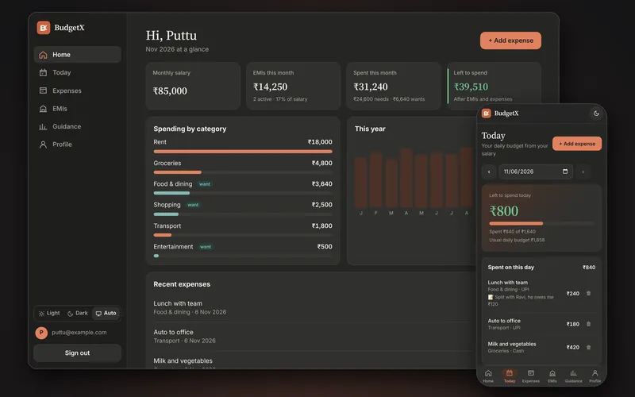

<!-- Generated by scripts/build.mjs. Edit CONFIG there and re-run instead of editing this file. -->

<a href="https://bhargavang.github.io/bhargavang/">
  <picture>
    <source media="(prefers-color-scheme: dark)" srcset="assets/hero-dark.svg">
    
  </picture>
</a>

**Associate Software Engineer at Torry Harris Business Solutions.** I build Java and Spring Boot backends and REST APIs at work, and websites, booking systems and online stores for small businesses on the side.

[Portfolio](https://bhargavang.github.io/bhargavang/) · [Email](mailto:bhargav.angadi@gmail.com) · Open to freelance projects

## Selected work

Working demos for the kinds of businesses I build for, plus my own finance app. [Watch them run on my portfolio →](https://bhargavang.github.io/bhargavang/#work)

<table>
<tr>
<td width="50%" valign="top">

<h3>Saffron Table</h3>
RESTAURANT WEBSITE

Menu, gallery and online table booking. Guest and owner both get an email; staff manage bookings from an admin page.

Next.js · TypeScript · Tailwind · PostgreSQL

<a href="https://saffron-table-one.vercel.app">Live site ↗</a> · <a href="https://github.com/bhargavang/saffron-table">Code ↗</a>

</td>
<td width="50%" valign="top">

<h3>CareDesk</h3>
BOOKING APP FOR CLINICS &amp; SALONS

Customers book a free slot online and staff run the day from a dashboard. The database rules out double bookings.

Java · Spring Boot · React · PostgreSQL · Docker

<a href="https://github.com/bhargavang/caredesk">Code ↗</a>

</td>
</tr>
<tr>
<td width="50%" valign="top">

<h3>Kora Threads</h3>
SHOPIFY THEME

A custom theme for a demo clothing brand, with a size guide, fabric and care details, and an Order on WhatsApp button.

Shopify · Liquid · JavaScript · CSS

<a href="https://github.com/bhargavang/kora-threads-theme">Code ↗</a>

</td>
<td width="50%" valign="top">

<h3>BudgetX</h3>
PERSONAL FINANCE APP

Track salary, EMIs and expenses and see what&#39;s safe to invest. Spring Boot microservices behind an API gateway.

Java · Spring Cloud · Kafka · Redis · MySQL · React

<a href="https://github.com/bhargavang/Budgetx">Code ↗</a>

</td>
</tr>
</table>

Earlier work, data analytics in Tableau: [Road Accident Analytics](https://github.com/bhargavang/Road-Accident-Analytics) · [HR Analytics](https://github.com/bhargavang/HR-DATA-ANALYTICS)

## Stack

**Backend:** Java, Spring Boot, Spring Cloud, REST APIs, Node.js  
**Frontend:** React, Next.js, TypeScript, Tailwind CSS  
**Data:** PostgreSQL, MySQL, Redis, Kafka  
**Tools:** Docker, Git, GitHub Actions, Maven, Vercel  
**Stores:** Shopify (Liquid), WordPress, WooCommerce

## Contributions

<picture>
  <source media="(prefers-color-scheme: dark)" srcset="https://raw.githubusercontent.com/bhargavang/bhargavang/output/github-contribution-grid-snake-dark.svg">
  
</picture>

Have a project in mind? [Email me](mailto:bhargav.angadi@gmail.com). I reply within 24 hours.
