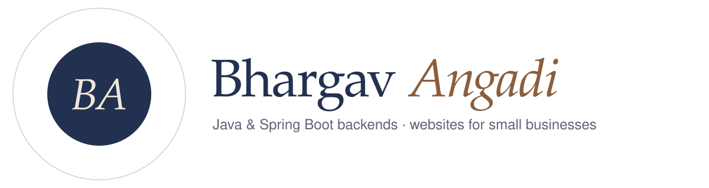

<!-- Generated by scripts/build.mjs. Edit CONFIG there and re-run instead of editing this file. -->

<picture><source media="(prefers-color-scheme: dark)" srcset="assets/header-dark.svg"></picture>

- I’m an **Associate Software Engineer** at Torry Harris Business Solutions, building Java and Spring Boot backends and REST APIs.
- On the side I build **websites, booking systems and online stores** for small businesses.
- Lately: <a href="https://github.com/bhargavang/saffron-table">Saffron Table</a> · <a href="https://github.com/bhargavang/caredesk">CareDesk</a> · <a href="https://github.com/bhargavang/kora-threads-theme">Kora Threads</a> · <a href="https://github.com/bhargavang/Budgetx">BudgetX</a>.

<picture><source media="(prefers-color-scheme: dark)" srcset="assets/tool-openjdk-dark.svg"></picture><picture><source media="(prefers-color-scheme: dark)" srcset="assets/tool-springboot-dark.svg"></picture><picture><source media="(prefers-color-scheme: dark)" srcset="assets/tool-react-dark.svg"></picture><picture><source media="(prefers-color-scheme: dark)" srcset="assets/tool-nextdotjs-dark.svg"></picture><picture><source media="(prefers-color-scheme: dark)" srcset="assets/tool-typescript-dark.svg"></picture><picture><source media="(prefers-color-scheme: dark)" srcset="assets/tool-postgresql-dark.svg"></picture><picture><source media="(prefers-color-scheme: dark)" srcset="assets/tool-redis-dark.svg"></picture><picture><source media="(prefers-color-scheme: dark)" srcset="assets/tool-apachekafka-dark.svg"></picture><picture><source media="(prefers-color-scheme: dark)" srcset="assets/tool-docker-dark.svg"></picture><picture><source media="(prefers-color-scheme: dark)" srcset="assets/tool-githubactions-dark.svg"></picture><picture><source media="(prefers-color-scheme: dark)" srcset="assets/tool-shopify-dark.svg"></picture><picture><source media="(prefers-color-scheme: dark)" srcset="assets/tool-tailwindcss-dark.svg"></picture><picture><source media="(prefers-color-scheme: dark)" srcset="assets/tool-mysql-dark.svg"></picture><picture><source media="(prefers-color-scheme: dark)" srcset="assets/tool-nodedotjs-dark.svg"></picture><picture><source media="(prefers-color-scheme: dark)" srcset="assets/tool-git-dark.svg"></picture><picture><source media="(prefers-color-scheme: dark)" srcset="assets/tool-vercel-dark.svg"></picture>

 

<b>Have a project in mind?</b>

<a href="mailto:bhargav.angadi@gmail.com"><picture><source media="(prefers-color-scheme: dark)" srcset="assets/button-email-dark.svg"></picture></a>&nbsp;&nbsp;<a href="https://bhargavang.github.io/bhargavang/"><picture><source media="(prefers-color-scheme: dark)" srcset="assets/button-portfolio-dark.svg"></picture></a>

