<!-- Generated by scripts/build.mjs. Edit CONFIG there and re-run instead of editing this file. -->

<a href="https://bhargavang.github.io/bhargavang/">
  
</a>

  
  
  
  




<a href="https://github.com/bhargavang/Budgetx"></a>

  

  
  

<a href="https://bhargavang.github.io/bhargavang/#work"></a>

  

  

<a href="https://bhargavang.github.io/bhargavang/#work"></a>

  

EARLIER WORK · DATA ANALYTICS 
  
  






  
  
  
  

